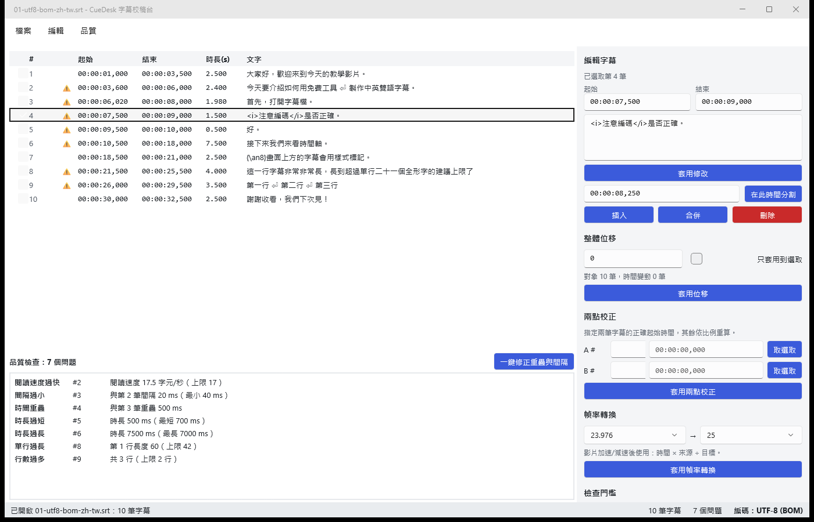
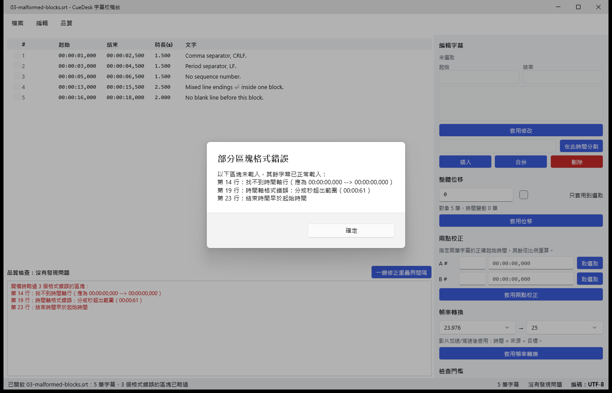
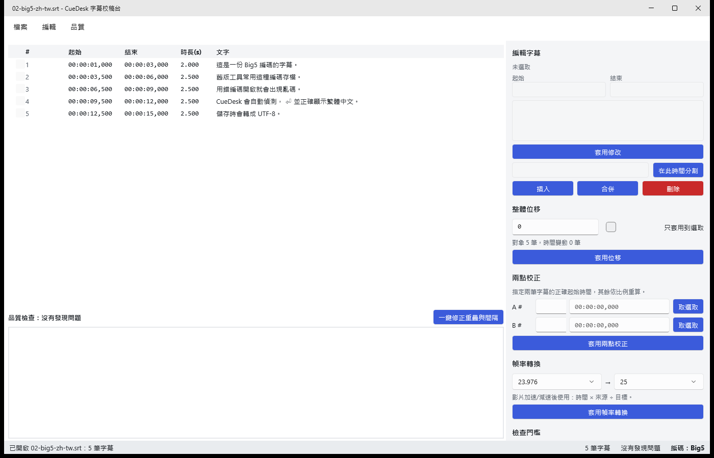

# CueDesk 字幕校稿台

[](https://github.com/OWNER/REPO/actions/workflows/ci.yml)

給教學影片創作者用的 Windows 桌面小工具：開啟 `.srt` → 校正時間 → 檢查品質 → 匯出，一次完成。
解決三個常見問題：Big5 字幕開起來亂碼、影片 23.976 → 25 fps 後字幕越後面越對不上、字幕閃太快觀眾來不及讀。



## 功能

| 類別 | 內容 |
|---|---|
| 開檔 | 檔案選擇器、拖放到視窗、最近開啟清單、命令列參數（`CueDesk.App.exe file.srt`）。自動偵測 UTF-8（有/無 BOM）、UTF-16（BOM）、無標記 Big5，結果顯示在狀態列 |
| 容錯解析 | 逗號或句點毫秒分隔、缺序號、多餘空行、CRLF/LF/CR 混用、區塊間缺空行。格式錯誤的區塊列出「第幾行、原因」，其餘照常載入 |
| 編輯 | 修改時間與文字、在指定時間分割、合併相鄰兩筆、刪除、在選取項後插入；序號自動重排、永遠依起始時間排序 |
| 批次時間 | 整體位移（全部或選取，含預覽摘要）、兩點校正、幀率轉換（23.976 / 24 / 25 / 29.97 / 30） |
| 品質檢查 | 重疊、間隔過小、時長過短、時長過長、閱讀速度過快、單行過長、行數過多；點選問題自動捲到該筆；門檻可調 |
| 一鍵修正 | 自動修正重疊與間隔過小；無法修正者保留並標示原因 |
| 復原/重做 | 100 層（需求 ≥ 50），批次操作與一鍵修正皆為一步 |
| 匯出 | SRT（UTF-8 可選 BOM、CRLF）、WebVTT、純文字逐字稿 |
| 設定 | 門檻、最近檔案、BOM 偏好、幀率選擇存於 `%LocalAppData%\CueDesk\settings.json`；損毀或遺失時用預設值並提示 |
| 未儲存保護 | 關閉視窗與開啟另一檔案前詢問「儲存 / 不儲存 / 取消」 |

<table>
<tr>
<td><br>格式錯誤的區塊列出行號與原因，其餘照常載入</td>
<td><br>無標記 Big5 自動偵測，狀態列顯示編碼</td>
</tr>
</table>

## 建置與執行

需求：Windows 10 1809 以上、.NET SDK 9.0.x、MAUI Windows workload。

```powershell
dotnet workload install maui-windows
dotnet build CueDesk.sln
dotnet test CueDesk.sln

# 執行（Debug）
dotnet run --project src/CueDesk.App -f net9.0-windows10.0.19041.0

# 發佈 win-x64（unpackaged、self-contained，可直接複製資料夾執行）
dotnet publish src/CueDesk.App/CueDesk.App.csproj -c Release -f net9.0-windows10.0.19041.0 -r win-x64 `
  --self-contained true -p:WindowsPackageType=None -o artifacts/CueDesk-win-x64
```

GitHub Actions（`.github/workflows/ci.yml`）在 `windows-latest` 上安裝 .NET 9 與 `maui-windows` workload，建置整個 solution、執行測試，並把 win-x64 發佈檔上傳為 artifact `CueDesk-win-x64`。

## 專案結構與模組

```
src/
  CueDesk.Core/          net9.0，零外部相依（只用 BCL）
    Model/               Cue（不可變 record）、CueList（排序、id）
    Encoding/            EncodingDetector
    Parsing/             SrtParser → ParseResult(Cues, Errors)
    Timing/              TimeFormat、IntMath（捨入）、TimeOperations（位移/兩點/幀率）、FrameRate
    Editing/             CueEditor（修改/分割/合併/刪除/插入）
    History/             UndoStack<T>
    Quality/             QualityChecker、GapFixer
    Text/                Markup（標籤辨識、顯示寬度）
    Export/              SubtitleWriters（SRT / WebVTT / 逐字稿）
    Settings/            AppSettings、SettingsStore
  CueDesk.Presentation/  net9.0，MainViewModel（CommunityToolkit.Mvvm），UI 服務以介面抽象
  CueDesk.App/           MAUI，net9.0-windows10.0.19041.0，unpackaged；只有 View 與平台服務
tests/
  CueDesk.Core.Tests/          165 個案例（含範例檔驗證）
  CueDesk.Presentation.Tests/  32 個案例（以 fake 取代對話框、檔案系統、設定）
samples/                       5 個範例檔、產生腳本、EXPECTED.md
```

相依方向：`App → Presentation → Core`。MAUI 專案只負責繫結與轉發平台事件（拖放、關窗、檔案對話框），所有行為（含「未儲存要不要存」的流程）都在可測試的 ViewModel 裡。

## 演算法與規則

### 時間與捨入

- 內部一律以 `long` 整數毫秒表示；格式 `HH:MM:SS,mmm`，上限 `99:59:59,999`。
- **捨入規則（全域唯一）**：以 `Int128` 做精確的整數/有理數運算，最後**四捨五入到毫秒，0.5 往遠離 0 的方向進位**（例：62562.5 → 62563）。
- 批次運算後的共同規則：
  - 結束時間 ≤ 0（**完全落在 0 之前**）→ 移除該筆
  - 起始 < 0 < 結束（**跨越 0**）→ 起始截為 0，結束照算
  - 捨入讓時長變成 0 → 補為 1 ms
  - 任何時間超過上限 → 整個操作取消

### 整體位移

起始與結束各加 Δ ms，套用上述共同規則。套用前顯示預覽摘要：

> 對象 N 筆，時間變動 X 筆，跨越 0 而起始截為 0：Y 筆，完全落在 0 之前將移除：Z 筆

「對象」是被套用的筆數（全部或選取），「變動」是保留下來且時間確實改變的筆數。

### 兩點校正

指定兩筆字幕 A、B 的正確起始時間。設原起始為 a₁、a₂，目標為 b₁、b₂：

```
t' = b₁ + (t − a₁) × (b₂ − b₁) / (a₂ − a₁)
```

起始與結束都套用（同時修正位移與漂移）。代入 t = a₁、a₂ 時整除，錨點**精確**落在 b₁、b₂。斜率為正，所以順序不會被破壞。

以下情況拒絕執行：
- 兩個錨點是同一筆
- 兩筆的原始起始時間相同
- 目標時間的先後順序與原順序相反，或兩個目標時間相等
- 目標時間為負

手算範例：a₁ = 10 000 → b₁ = 11 000，a₂ = 110 000 → b₂ = 114 000，斜率 1.03，t = 60 000 → 11 000 + 50 000 × 1.03 = **62 500**。

### 幀率轉換

情境是影片被**加速或減速**：例如 23.976 → 25 的 PAL speedup，幀數不變、片長變短，這就是「越後面越對不上」的原因。時間依比例換算：

```
t' = t × 來源幀率 / 目標幀率      23.976 = 24000/1001，29.97 = 30000/1001（精確比例）
```

| 轉換 | t = 60 000 ms 時的手算結果 |
|---|---|
| 23.976 → 25 | 60000 × 24000 / 25025 = 57542.46 → **57542** |
| 25 → 23.976 | 60000 × 25025 / 24000 = 62562.5 → **62563** |
| 24 → 25 / 25 → 24 | **57600** / **62500** |
| 25 → 29.97 / 29.97 → 25 | **50050** / 71928.07 → **71928** |

### 編輯規則

- **修改時間**：必須 0 ≤ 起始 < 結束 ≤ 上限，否則拒絕並說明原因。
- **分割**（在時間 T）：
  - 需滿足 起始 < T < 結束，預設 T 取中點。
  - 結果為 `[起始, T]` 與 `[T, 結束]` 兩段，中間沒有間隔；如需間隔可用一鍵修正補上。
  - 前段保留原 id。
  - 文字的切法：多行文字從行與行之間切，前一半的行歸前段；單行文字依時間比例找最近的空白或標點（含全形「，。！？、；：」），找不到時就在比例位置直接切。
- **合併**：選一筆時與下一筆合併，選兩筆時兩筆必須相鄰。起始取兩者最小值、結束取最大值，文字以換行連接。
- **插入**（在選取項之後；沒有選取時插在最前面）：
  - 起始 = 選取項結束 + 最小間隔。
  - 結束 = min(起始 + 2000, 下一筆起始 − 最小間隔)。
  - 如果夾不出空間，就用 2000 ms，重疊交由品質檢查標出。
- 序號不儲存，就是排序後的位置，所以任何操作之後自動正確。排序採 stable sort：起始時間相同時保留原相對順序。

### 品質檢查的判定方式

每一筆都和**排序後的前一筆**比較；同一筆可以同時有多個不同類型的問題。

| 類型 | 條件 | 預設 |
|---|---|---|
| 時間重疊 | 本筆起始 − 前筆結束 < 0 | |
| 間隔過小 | 0 ≤ 間隔 < 最小間隔（與重疊互斥，不重複回報） | 40 ms |
| 時長過短 | 時長 < 最短 | 700 ms |
| 時長過長 | 時長 > 最長 | 7000 ms |
| 閱讀速度過快 | 字元數 ÷ 秒數 > 上限 | 17 字元/秒 |
| 單行過長 | 任一行字元數 > 上限 | 42 |
| 行數過多 | 行數 > 上限 | 2 行 |

**字元數（閱讀速度與單行長度共用）**：
1. 移除行內標籤 `<i>`、`<b>`、`<u>`、`<font …>` 以及樣式碼 `{\an8}` 之類，這些不計入。
2. 依**顯示寬度**計數：East Asian Wide / Fullwidth 字元算 **2**，包含中日韓文字、全形標點、全形英數；其他字元算 **1**，空白與英文標點也算。
3. 閱讀速度不計換行字元。

這樣一組門檻就能同時適用中英文：英文就是業界常用的 17 cps 與每行 42 字；繁體中文相當於約 8.5 字/秒、每行 21 字，接近 Netflix 繁中規範的 9 字/秒、16 字/行。中英混排的字幕也能自然處理。

例：
- 「今天我們來學習如何使用字幕軟體」共 15 字，權重 30。放 2 秒是 15 cps，通過；放 1.5 秒是 20 cps，判定過快。
- 英文 36 字元放 2 秒是 18 cps，判定過快；34 字元剛好 17 cps，通過。

### 一鍵修正

依序處理每組「重疊」或「間隔過小」，把**前一筆的結束**改成「後一筆起始 − 最小間隔」，**起始時間永遠不動**，所以排序也不會變。

修正後前一筆的時長必須 ≥ 1 ms，做不到就不修，並在品質面板標示原因，例如「兩筆起始時間相同，無法只靠縮短前一筆修正」。面板在修正前就會先做一次試算，把無法修正的項目標出來。

整個修正算一步復原。修正後可能因時長變短而出現新的「時長過短」，這是預期行為。

### 編碼偵測

依序判斷，第一個成立的就採用：

1. `EF BB BF` → UTF-8 (BOM)
2. `FF FE` / `FE FF` → UTF-16 LE / BE
3. 嚴格 UTF-8 解碼成功 → UTF-8
4. 嚴格 Big5（cp950）解碼成功 → Big5
5. 都不成立時，以 Big5 搭配替代字元解碼，狀態列標示「部分字元無法辨識」

### 匯出

- **SRT**：序號從 1 開始重排，時間用 `,`，換行一律 CRLF，UTF-8 是否加 BOM 依設定（預設加）；文字與標籤原樣輸出。
- **WebVTT**：
  - 檔頭為 `WEBVTT` 加一個空行，時間用 `.`。
  - 保留 `<i>`、`<b>`、`<u>`（統一轉小寫）；`<font>` 和 `{\an8}` 這類 VTT 不支援的標記會移除。
  - 文字中的 `&`、`<`、`>` 會跳脫，因此文字裡的 `-->` 會變成 `--&gt;`。
  - cue 內的空行會移除。
- **純文字逐字稿**：移除所有標記，每行字幕輸出一行，沒有時間。

### 儲存

「儲存」一律寫成 SRT（UTF-8）。如果原檔是 Big5 或 UTF-16，第一次儲存前會詢問是否改用 UTF-8 儲存。

## 設計取捨

- **Snapshot 式復原**：每一步存整份不可變清單，而不是 Command pattern。批次操作天生就是一步，也不必替每種操作寫反向邏輯。2 萬筆 × 100 層，存的是 record 的參考，記憶體可接受。「是否已修改」用存檔時的 snapshot 判斷，所以復原回存檔狀態時會自動變回未修改。
- **編輯是純函式**：舊清單進、排序好的新清單出。容易測試，也不會有序號不同步的問題。
- **ViewModel 獨立成 `CueDesk.Presentation`**：Core 保持零相依；對話框、檔案對話框、檔案系統、設定都透過介面注入，所以「未儲存詢問」、拖放判斷、預覽摘要等流程都有單元測試。
- **工具面板而非對話框**：位移、兩點校正、幀率轉換、門檻設定放在右側面板，套用前用確認對話框顯示預覽摘要。這樣 ViewModel 比較好測試，操作也比較少跳窗。
- **字元寬度加權而非中英各一組門檻**：設定簡單，混合語言也有一致的行為。
- **平台功能直接用 WinUI API**：關窗攔截用 `AppWindow.Closing`（MAUI 在 Windows 上沒有可以取消的關閉事件），檔案對話框用 WinRT picker 搭配 HWND 初始化。沒有額外引入 CommunityToolkit.Maui。
- **不使用付費授權套件**：只用 `CommunityToolkit.Mvvm`（MIT）與 xUnit；斷言用 xUnit 內建（FluentAssertions v8 已改為付費授權），mock 一律用手寫 fake。

## 已知限制

- 重疊與間隔只比較排序後相鄰的兩筆；巢狀重疊（一筆長字幕蓋住後面好幾筆）要修正一次後才會完全浮現。
- 一律以 UTF-8 存檔，不支援寫回 Big5 或 UTF-16。
- 編碼偵測的限制：
  - 無標記的 GBK（簡體）檔可能被誤判為 Big5。
  - 純 ASCII 檔會顯示為 UTF-8。
  - 不支援沒有 BOM 的 UTF-16。
  - Big5-HKSCS 擴充字可能缺字。
- 字幕文字行中如果含有 `-->`，會被當成時間軸行。文字中成對出現的 `<` 和 `>` 會被當成標籤。
- 在標籤中間分割（例如 `<i>…</i>` 中間），兩段的標籤不會自動補齊。
- `{\an8}` 等定位碼匯出 WebVTT 時會移除，不會轉成 VTT 的位置設定。
- 以系統管理員身分執行時，Windows 會封鎖從檔案總管拖放到視窗。
- 游標在文字框內時，Ctrl+Z 會作用在文字框本身的復原，而不是字幕的復原。
- 每次編輯都會重建整個列表的 row；2 萬筆時仍可使用，但操作會有短暫延遲。
- 設定檔損毀時，原檔會備份為 `settings.corrupt.json`，下次儲存設定時以預設值覆寫。
- 視窗大小與位置不會記憶。
- 未處理的例外會寫入 `%LocalAppData%\CueDesk\crash.log`，供除錯使用。

## 範例資料

`samples/` 內含 5 個範例檔：UTF-8 BOM 繁中、Big5 繁中、含格式錯誤區塊、英文、UTF-16 中英對照。預期的解析與檢查結果寫在 [samples/EXPECTED.md](samples/EXPECTED.md)，並由 `SampleFilesTests` 自動驗證。
