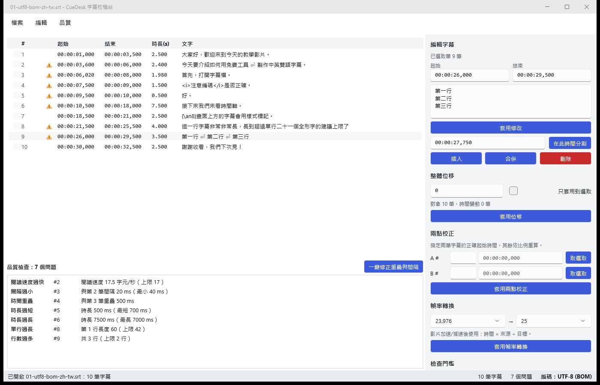
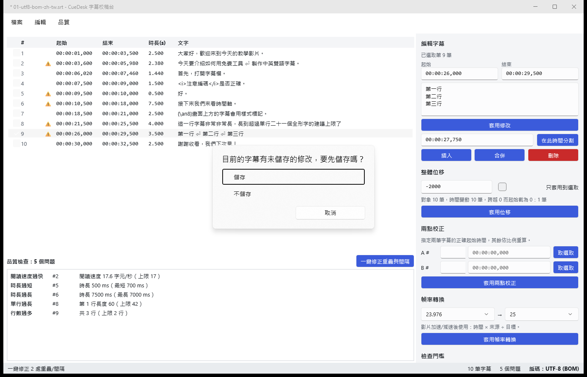
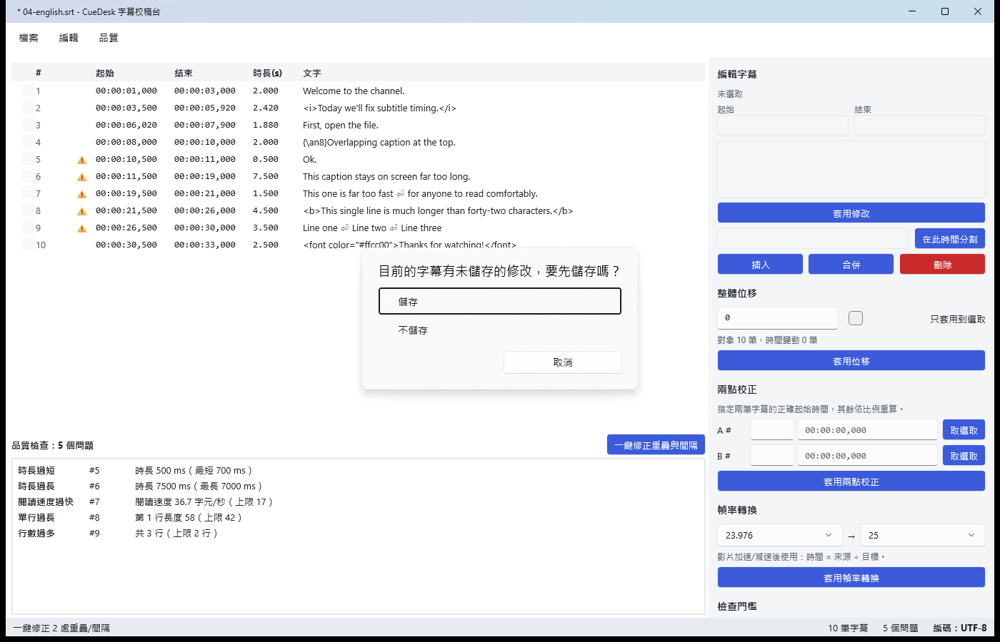
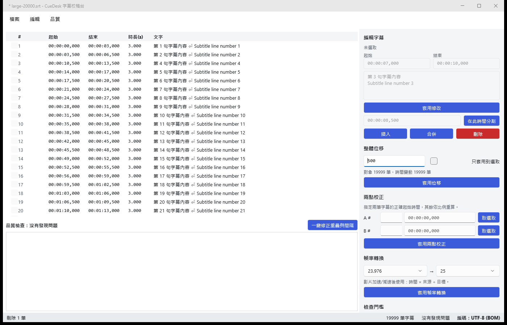
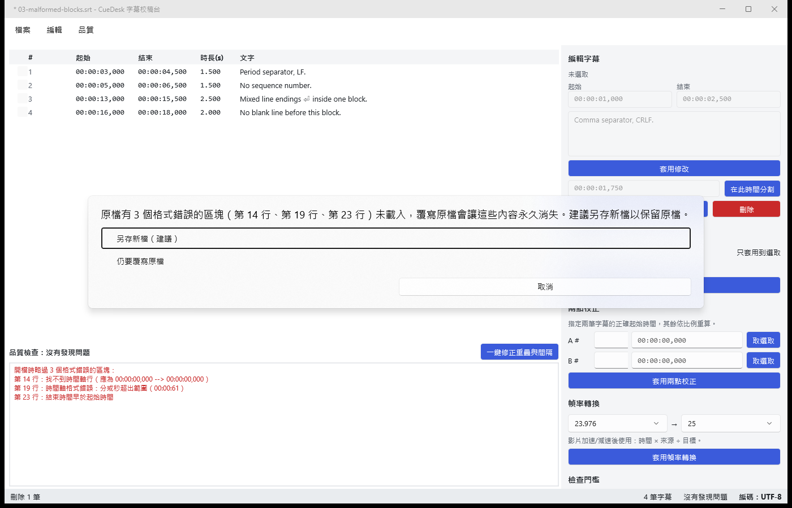

# CueDesk 測試報告

| 項目 | 內容 |
|---|---|
| 版本 | 第 2 版：已納入程式碼審查回饋的修正（見第 7 節 #10–#16） |
| 測試日期 | 2026-10-19 |
| 測試環境 | Windows 11 Pro 10.0.26200、.NET SDK 9.0.315、maui-windows workload 9.0.111、xUnit 2.9.2；CI 使用 GitHub Actions `windows-latest` |
| 測試範圍 | 需求規格全文、驗收標準 1–17、交付物、程式碼審查回饋 |

## 1. 結論摘要

| 類別 | 數量 | 通過 | 失敗 | 待驗證 |
|---|---:|---:|---:|---:|
| 單元測試（`dotnet test`） | 226 | 226 | 0 | 0 |
| UI 實測（UI Automation 自動操作＋人工拖放） | 17 | 17 | 0 | 0 |
| 驗收標準 | 17 | 17 | 0 | 0 |

- CI：GitHub Actions 綠燈，見 [run 39192748484](https://github.com/hn83320589/CueDesk/actions/runs/39192748484)（程式碼 commit `922d928`；步驟與 artifact 見第 8 節）。
- 程式碼覆蓋率：CueDesk.Core **85.2%** 行 / 77.6% 分支（由 Core.Tests 量測）；CueDesk.Presentation **79.9%** 行 / 69.6% 分支。
- 拖放（UI-14、UI-15）由人工操作驗證，並以 UI Automation 讀取畫面核對，見第 6 節。

## 2. 驗收標準對照

| # | 驗收標準 | 判定方式 | 證據 | 結果 |
|---|---|---|---|---|
| 1 | UTF-8（含/不含 BOM）、UTF-16、無標記 Big5 皆能開啟，中文不亂碼，狀態列顯示偵測結果 | 單元測試＋實測 | `EncodingDetectorTests`（7）、`SampleFilesTests.Sample1/2/5/6`（範例 6 為中文、無 BOM 的 UTF-8）、`Open_loads_cues_and_shows_detected_encoding`；實測 UI-01、UI-05 | ✅ |
| 2 | 逗號與句點分隔、缺序號、多餘空行、CRLF/LF 混用皆可解析；錯誤區塊列出行號與原因，其餘照常載入 | 單元測試 | `SrtParserTests`（17）、`SampleFilesTests.Sample3`（第 14、19、23 行）；實測 UI-02 | ✅ |
| 3 | 匯入再匯出 SRT，時間與文字一致（行內標籤與換行保留）；CRLF；BOM 依選項 | 單元測試 | `Srt_round_trip_*`、`Every_sample_round_trips_through_srt_export`（6 檔）、`Srt_empty_cue_has_no_extra_blank_line_and_round_trips`、`Utf8_bytes_have_bom_only_when_requested`、`Save_respects_bom_setting_and_uses_crlf`；實測 UI-06、UI-17 | ✅ |
| 4 | 修改、分割、合併、刪除、插入後序號正確、依起始排序；分割與合併規則寫在 README 且有測試 | 單元測試 | `CueEditorTests`（20）、`Split_merge_insert_delete_keep_sequence_consistent`、`Apply_edit_changes_time_and_text_in_one_undo_step_and_resorts`；README〈編輯規則〉 | ✅ |
| 5 | 整體位移不產生負時間，「完全落在 0 之前」「跨越 0」規則明確且有測試；預覽摘要筆數正確 | 單元測試 | `Shift_*`（9 個）、`Shift_preview_reports_counts_before_applying`；README〈整體位移〉；實測 UI-04 | ✅ |
| 6 | 兩點校正後錨點精確、其餘與手算一致、順序不變 | 單元測試（含手算） | `TwoPoint_places_anchors_exactly_and_others_match_hand_calculation`（62 500 等手算值）、`TwoPoint_rounds_half_away_from_zero`、4 個拒絕情境 | ✅ |
| 7 | 幀率轉換方向正確，涵蓋 23.976↔25、24↔25、25↔29.97，與手算一致 | 單元測試（含手算） | `FrameRate_conversion_matches_hand_calculation`（8 組，含三組雙向）、`FrameRate_speedup_shortens_and_slowdown_lengthens` | ✅ |
| 8 | 七種檢查各自觸發、互不干擾，門檻調整後結果改變 | 單元測試 | `QualityCheckerTests`（21）：每種單獨觸發、`Clean_subtitles_have_no_issues`、`Changing_thresholds_changes_results`；`Sample1/Sample4` 各觸發 7 種一次；實測 UI-08。另加第 8 種「空白字幕」，同樣單獨觸發 | ✅ |
| 9 | 閱讀速度對英文與繁中都合理，判定方式寫在 README | 單元測試＋README | `Reading_speed_english_*`、`Reading_speed_chinese_weights_wide_characters`、`DisplayWidth_*`；README〈品質檢查的判定方式〉 | ✅ |
| 10 | 一鍵修正後時長不為零或負，無法修正者保留並標示原因，整個修正一步復原 | 單元測試 | `GapFixerTests`（8）、`Fix_gaps_is_one_undo_step`、`Issues_update_after_open_and_mark_unfixable_ones`；實測 UI-06 | ✅ |
| 11 | 復原/重做至少 50 層，批次一步還原，新操作清空重做 | 單元測試 | `UndoStackTests`（7，含 60 層）、`At_least_fifty_view_model_operations_can_be_undone`、`Shift_applies_after_confirmation_as_one_step`、`New_edit_after_undo_clears_redo` | ✅ |
| 12 | WebVTT 與純文字匯出格式正確（標頭、句點分隔、標籤處理） | 單元測試 | `Vtt_*`（3）、`Transcript_has_text_only_without_times_or_tags`、`Export_vtt_writes_chosen_path_and_keeps_modified_state` | ✅ |
| 13 | 設定與最近檔案關閉重開後保留；未儲存的修改在關閉與開啟他檔前詢問；設定檔損毀不崩潰 | 實測 | UI-06～UI-11、UI-16；另有單元測試 `Unreadable_settings_path_returns_defaults_instead_of_throwing`（權限不足也不崩潰） | ✅ |
| 14 | 拖放 .srt 可開啟，拖入非字幕檔有明確提示 | 實測 | 人工實測 UI-14、UI-15；單元測試 `Dropping_srt_opens_it`、`Dropping_non_subtitle_file_shows_clear_message` | ✅ |
| 15 | 核心邏輯單元測試至少 50 個案例，`dotnet test` 全數通過 | 執行測試 | 226 個案例（Core 178、Presentation 48），0 失敗；CI 上同樣全數通過 | ✅ |
| 16 | README 含建置步驟、截圖、模組說明、公式、檢查規則、已知限制 | 檢視 README | 各章節皆已具備；CI 徽章指向 `hn83320589/CueDesk` 的 `ci.yml`，CI 綠燈後顯示 passing | ✅ |
| 17 | GitHub Actions 在 Windows 建置 MAUI 與測試、CI 綠燈、README 徽章、上傳 win-x64 artifact | 檢視 Actions | [run 39192748484](https://github.com/hn83320589/CueDesk/actions/runs/39192748484)：全部步驟成功，已上傳 `CueDesk-win-x64`（86.6 MB）與 `test-results`（詳見第 8 節） | ✅ |

## 3. 需求逐項檢查

### 功能需求

| 需求 | 實作位置 | 驗證 | 結果 |
|---|---|---|---|
| 開啟 .srt：檔案選擇器、拖放 | `MainViewModel.File.cs`、`FileDialogService`、`MainPage.OnDrop` | 單元＋UI-01、UI-14、UI-15 | ✅ |
| 編碼偵測：UTF-8±BOM、UTF-16 BOM、Big5，狀態列顯示 | `EncodingDetector` | 單元＋UI-01 | ✅ |
| 容錯解析與錯誤行號 | `SrtParser` | 單元＋UI-02 | ✅ |
| 列表顯示序號、起始、結束、時長、文字 | `MainPage.xaml`、`CueRowViewModel` | UI-01 截圖 | ✅ |
| 修改、分割、合併、刪除、插入；序號重排；依起始排序 | `CueEditor` | 單元 | ✅ |
| 整體位移（全部或選取、不為負、預覽摘要） | `TimeOperations.Shift`、`MainViewModel.Timing.cs` | 單元＋UI-04 | ✅ |
| 兩點校正（錯誤時拒絕） | `TimeOperations.TwoPointSync` | 單元 | ✅ |
| 幀率轉換（5 種幀率、精確比例） | `TimeOperations.ConvertFrameRate`、`FrameRate` | 單元 | ✅ |
| 品質面板 7 種檢查、點選捲動、門檻可調、預設值正確 | `QualityChecker`、`MainPage` | 單元＋UI-03、UI-08 | ✅ |
| 一鍵修正（只縮短前一筆結束、不為零、標示原因） | `GapFixer` | 單元＋UI-06 | ✅ |
| 復原/重做 ≥ 50 層，批次一步 | `UndoStack`（100 層） | 單元 | ✅ |
| 匯出 SRT（BOM 可選、CRLF）、WebVTT、純文字 | `SubtitleWriters` | 單元＋UI-06、UI-17 | ✅ |
| 設定與最近檔案存 JSON、未儲存詢問、損毀/遺失不崩潰 | `SettingsStore`、`CloseGuard`、`ConfirmDiscardChangesAsync` | 單元＋UI-06～11 | ✅ |

### 程式碼審查回饋（第 2 版新增）

| 審查發現 | 處理 | 驗證 | 結果 |
|---|---|---|---|
| 存檔會悄悄丟掉原檔中格式錯誤的區塊（資料遺失） | 要覆寫一個「開檔時有區塊被略過」的原檔時，列出遺失的行號，讓使用者選「另存新檔（建議）/ 仍要覆寫原檔 / 取消」；關窗時選「儲存」也一樣會詢問 | 5 個 VM 測試（`Overwriting_source_with_skipped_blocks_warns_and_cancel_writes_nothing` 等）；實測 UI-16 | ✅ |
| 存檔不是原子寫入、沒有備份 | `SafeFileWriter`：先寫入同資料夾的暫存檔並 flush 到磁碟，再以 `File.Replace` 替換，保留 `.bak`（可在選單關閉）；失敗時原檔不變且不留暫存檔 | `SafeFileWriterTests`（4，含模擬寫入失敗）、`Failed_write_reports_error_keeps_original_and_stays_modified`；實測 UI-17 | ✅ |
| `SettingsStore.Load` 沒攔 `UnauthorizedAccessException` | 改為先讀檔，任何讀取失敗（含權限不足）都改用預設值並提示；備份損毀檔時也一併處理 | `Unreadable_settings_path_returns_defaults_instead_of_throwing` | ✅ |
| 原檔是無 BOM 的 UTF-8 時，存檔會悄悄加上 BOM | 寫出的編碼與原檔不同時一律詢問（含 BOM 的增減），存過一次後不再重複詢問 | `Saving_utf8_without_bom_asks_before_adding_a_bom` 等 3 個測試 | ✅ |
| 新插入的字幕沒有文字也沒有任何提示；匯出 SRT 時空字幕多一行空白 | 新增「空白字幕」檢查；空字幕不輸出文字行 | `Empty_text_is_detected_alone`（4 組）、`Srt_empty_cue_has_no_extra_blank_line_and_round_trips`、`Inserted_cue_is_flagged_until_text_is_entered` | ✅ |
| 範例缺「中文、無 BOM 的 UTF-8」 | 新增 `samples/06-utf8-nobom-zh-tw.srt`，並寫入 EXPECTED.md | `Sample6_utf8_without_bom_chinese_is_clean_and_not_garbled`＋round trip | ✅ |
| 報告的 CI 項目仍是「推送後確認」 | 填入實際的 CI run 連結、各步驟結果與 artifact | 第 1、2、8 節 | ✅ |

### 技術與平台限制

| 限制 | 檢查結果 |
|---|---|
| C#、.NET 9、.NET MAUI、僅 Windows（`net9.0-windows10.0.19041.0`）、unpackaged | `CueDesk.App.csproj`：單一 TFM、`WindowsPackageType=None`、`RuntimeIdentifier=win-x64`、self-contained；Release 發佈檔可直接執行（UI-13） ✅ |
| MVVM（CommunityToolkit.Mvvm） | `CueDesk.Presentation` 使用 `[ObservableProperty]`、`[RelayCommand]` ✅ |
| 解析、編碼、時間運算、檢查、匯出、復原堆疊放在獨立的 Class Library（純 net9.0，不引用 MAUI） | `CueDesk.Core`：`net9.0`、零 PackageReference ✅ |
| ViewModel 邏輯放在 Library 也要有測試 | `CueDesk.Presentation`（net9.0），有 48 個測試 ✅ |
| 不使用資料庫；設定 JSON 位於 `%LocalAppData%\CueDesk\` | `SettingsStore.DefaultPath`；UI-09 確認檔案自動建立 ✅ |
| 不使用付費授權套件 | 只有 CommunityToolkit.Mvvm（MIT）、xunit（Apache-2.0）、Microsoft.NET.Test.Sdk（MIT）、coverlet.collector（MIT）、MAUI ✅ |
| 不呼叫外部網路服務 | 程式碼中沒有 HttpClient 或任何網路 API ✅ |

### 假設事項

| 假設 | 檢查結果 |
|---|---|
| 小時最多兩位、毫秒精度 | `TimeFormat.MaxMs = 99:59:59,999`，超過就拒絕 ✅ |
| 單檔 ≤ 20 000 筆、5 MB | 超過 5 MB 拒絕開啟；20 000 筆的效能見 `LargeFileTests`、`Twenty_thousand_cue_file_opens_and_edits_quickly` 與 UI-12 ✅ |
| 標籤與 `{\an8}` 原樣保留、不計入字元數 | `Preserves_inline_tags_and_style_codes`、`Reading_speed_ignores_tags_and_line_breaks` ✅ |
| 兩點錨點須為不同兩筆、順序一致，否則拒絕 | `TwoPoint_rejects_*`（4 個）＋ VM `Two_point_with_reversed_targets_is_rejected` ✅ |
| 23.976 = 24000/1001、29.97 = 30000/1001 | `FrameRate` 常數 ✅ |
| 捨入規則自訂並說明 | 0.5 往遠離 0 的方向進位（`IntMath.DivRound`），README 有說明 ✅ |

### 交付物

| 交付物 | 位置 | 結果 |
|---|---|---|
| Solution（MAUI、Core、Tests） | `CueDesk.sln`（5 個專案） | ✅ |
| README | `README.md` | ✅ |
| ≥ 5 個範例檔（UTF-8 BOM、Big5、格式錯誤、英文、繁中）與預期結果說明 | `samples/` 共 6 個 `.srt`（另含 UTF-16 中英對照、無 BOM 的 UTF-8 繁中）、`samples/EXPECTED.md`（由 `SampleFilesTests` 驗證） | ✅ |
| CI（setup-dotnet 9.0.x、安裝 MAUI workload） | `.github/workflows/ci.yml`；綠燈 run 見第 8 節 | ✅ |

## 4. 單元測試

指令：`dotnet test CueDesk.sln --collect:"XPlat Code Coverage" --logger trx`

| 測試類別 | 案例數 | 涵蓋內容 |
|---|---:|---|
| Core.Tests.Parsing.SrtParserTests | 17 | 容錯解析、錯誤行號 |
| Core.Tests.Encoding.EncodingDetectorTests | 7 | 5 種編碼與替代字元 |
| Core.Tests.Timing.TimeFormatTests | 18 | 時間格式化與解析 |
| Core.Tests.Timing.IntMathTests | 7 | 捨入規則 |
| Core.Tests.Timing.TimeOperationsTests | 27 | 位移、兩點校正、幀率（含手算值） |
| Core.Tests.Editing.CueEditorTests | 20 | 編輯操作與規則 |
| Core.Tests.History.UndoStackTests | 7 | 復原深度與重做清空 |
| Core.Tests.Quality.QualityCheckerTests | 21 | 七種檢查＋空白字幕、門檻 |
| Core.Tests.Quality.GapFixerTests | 8 | 一鍵修正 |
| Core.Tests.Text.MarkupTests | 9 | 標籤移除與字元寬度 |
| Core.Tests.Export.SubtitleWritersTests | 11 | SRT、VTT、逐字稿、round trip、空字幕 |
| Core.Tests.IO.SafeFileWriterTests | 4 | 原子寫入、`.bak`、模擬寫入失敗 |
| Core.Tests.Settings.SettingsStoreTests | 8 | JSON 讀寫、損毀、遺失、不合法值、權限不足 |
| Core.Tests.SampleFilesTests | 13 | `samples/EXPECTED.md` 的所有斷言（6 個範例） |
| Core.Tests.LargeFileTests | 1 | 20 000 筆、< 5 MB 的全流程 |
| Presentation.Tests.MainViewModelTests | 48 | 開檔、未儲存詢問、存檔安全、編碼確認、編輯、批次、品質、設定、規模 |
| **合計** | **226** | **全部通過** |

效能（Debug build，本機）：
- 20 000 筆依序執行解析、檢查、幀率轉換、一鍵修正、合併、匯出：全流程 < 0.2 秒。
- ViewModel 開啟 20 000 筆再加上刪除與復原：< 1 秒。

完整案例清單見[附錄](#附錄全部單元測試案例)。

## 5. UI 實測紀錄

方法：以 UI Automation 操作實際執行中的 CueDesk（Debug build；UI-13～15 使用 Release 發佈檔）。讀取狀態列、清單、對話框的實際文字，以及寫出檔案的 bytes 來判定結果。範例檔先複製到暫存資料夾再測試，不修改 repo 內的檔案。

| 編號 | 情境 | 步驟 | 預期 | 實際 | 結果 |
|---|---|---|---|---|---|
| UI-01 | 5 種範例的開檔與編碼顯示 | 以命令列逐一開啟範例 1～5 | 編碼／筆數／問題數：UTF-8 (BOM)/10/7、Big5/5/0、UTF-8/5/0、UTF-8/10/7、UTF-16 LE/3/0 | 5 個全部相符 | ✅ |
| UI-02 | 格式錯誤區塊的提示 | 開啟 `03-malformed-blocks.srt` | 對話框與面板列出第 14、19、23 行與原因，其餘 5 筆載入 | 相符 | ✅ |
| UI-03 | 點選問題後捲動到該筆 | 開啟範例 1，點選品質面板第 7 項（#9 行數過多） | 選取第 9 筆，編輯區起始時間為 00:00:26,000 | 「已選取第 9 筆」「00:00:26,000」 | ✅ |
| UI-04 | 位移預覽摘要 | 範例 1 輸入位移 -2000 | 對象 10、變動 10、截為 0 的 1 筆 | 「對象 10 筆，時間變動 10 筆，跨越 0 而起始截為 0：1 筆」 | ✅ |
| UI-05 | Big5 中文不亂碼 | 開啟 `02-big5-zh-tw.srt`，讀取列表文字 | 正確的繁體中文 | 「這是一份 Big5 編碼的字幕。」等全部正確 | ✅ |
| UI-06 | 關閉時的未儲存詢問與儲存 | 一鍵修正 → 關閉 → 取消 → 再關閉 → 儲存 | 詢問出現；取消時不關閉；儲存後寫檔並結束；檔案有 BOM、全為 CRLF、修正值正確 | 詢問出現；取消時仍執行中；儲存後結束；BOM 正確、單獨 LF 為 0 個、#2 結束為 5980、#3 結束為 7460 | ✅ |
| UI-07 | 開啟其他檔案前的詢問 | 修改英文檔 → 從「最近開啟」選單開 Big5 檔 → 取消 → 再開 → 不儲存 | 詢問出現；取消時保留原檔；不儲存後切換到 Big5 檔 | 相符（標題由「* 04-english.srt」變為「02-big5-zh-tw.srt」，編碼變為 Big5） | ✅ |
| UI-08 | 門檻與最近檔案在重開後保留 | 最小間隔改為 100 → 套用 → 關閉 → 重開 | 欄位仍為 100；最近開啟選單列出曾開過的檔案 | 最小間隔為 100；JSON 與選單都有 5 筆最近檔案，順序為最新在前 | ✅ |
| UI-09 | 設定檔遺失 | 刪除 `%LocalAppData%\CueDesk` 後啟動 | 不崩潰；狀態列提示；自動建立預設設定檔 | 「找不到設定檔，已使用預設值。」；settings.json 已建立 | ✅ |
| UI-10 | 設定檔損毀 | 寫入不合法的 JSON 後啟動 | 不崩潰；顯示對話框；使用預設值；保留備份 | 對話框「設定檔已損毀…」；最小間隔為 40；`settings.corrupt.json` 存在 | ✅ |
| UI-11 | 設定值超出範圍 | `minGapMs: -5` 後啟動 | 該欄位還原為預設值並提示，其他欄位保留 | 「設定值不合法，已還原為預設值：最小間隔」；最小間隔為 40 | ✅ |
| UI-12 | 20 000 筆效能 | 開啟 1.78 MB、20 000 筆的檔案，刪除一筆，輸入位移 | 可正常操作 | 開檔 1.6 秒、刪除 0.5 秒、預覽「對象 19999 筆」即時更新 | ✅ |
| UI-13 | Release 發佈檔 | 執行 `dotnet publish -r win-x64 --self-contained`，以發佈檔開啟 UTF-16 範例 | 可啟動並正確開檔 | 標題、編碼 UTF-16 LE、3 筆都正確 | ✅ |
| UI-14 | 拖放 .srt 開啟 | 人工：從檔案總管把 `04-english.srt` 拖到清單區（一般權限） | 開啟該檔 | 標題為 04-english.srt、10 筆字幕、編碼 UTF-8、狀態「已開啟 04-english.srt：10 筆字幕」 | ✅ |
| UI-15 | 拖放非字幕檔 | 人工：把 `notes.txt` 拖進視窗 | 顯示「只能開啟 .srt 字幕檔」並列出檔名 | 對話框「不支援的檔案：只能開啟 .srt 字幕檔。拖入的檔案：notes.txt」，原文件不受影響 | ✅ |
| UI-16 | 覆寫有略過區塊的原檔前警告 | 開啟 `03-malformed-blocks.srt` → 刪除一筆 → 關閉 → 儲存；另外從「檔案 → 儲存」再試一次 | 兩種路徑都出現警告並列出行號；取消時原檔不變 | 「原檔有 3 個格式錯誤的區塊（第 14 行、第 19 行、第 23 行）未載入，覆寫原檔會讓這些內容永久消失。建議另存新檔以保留原檔。」；取消後原檔 bytes 不變、資料夾內沒有其他檔案 | ✅ |
| UI-17 | 原子寫入與 `.bak` | 開啟範例 1 複本 → 一鍵修正 → 從「檔案 → 儲存」存檔 | 原檔被替換；`.bak` 等於舊內容；沒有殘留暫存檔 | 資料夾只剩 `01-…srt` 與 `01-…srt.bak`；`.bak` 與原檔逐 byte 相同；新檔有 BOM、#2 結束為 5980 | ✅ |

UI-16 中「仍要覆寫原檔」與「另存新檔」兩個分支的點擊，由 ViewModel 單元測試驗證，原因見第 6 節。

佐證截圖（只擷取 CueDesk 視窗本身）：

| UI-03 點選問題後捲動並選取 | UI-06 關閉前的未儲存詢問 |
|---|---|
|  |  |
| **UI-07 開啟其他檔前的詢問** | **UI-12 20 000 筆** |
|  |  |
| **UI-16 覆寫前的遺失警告** | |
|  | |

UI-16 截圖右側的編輯區還顯示著已刪除那一筆的內容，這是本輪發現並已修正的問題（第 7 節 #16）。

## 6. 測試方法說明

### UI-14 / UI-15 拖放（人工）

- 自動化沒能完成拖放，共試了 3 種方式：
  1. 不按住滑鼠直接呼叫 OLE `DoDragDrop`
  2. 用 `mouse_event` 模擬按下、移動、放開
  3. 改用 `SendInput`：回傳錯誤 87，原因是測試腳本的 `INPUT` 結構大小寫錯
- 依「同一問題最多 3 次」的規則停止後，改為人工驗證。
- 第一次人工拖放時出現「禁止」游標。原因是測試用的 shell 以系統管理員權限（High integrity）執行，從它啟動的 CueDesk 也跟著是高權限，Windows UIPI 因此封鎖從一般權限的檔案總管拖放進來。這實際驗證了 README 的已知限制，不是程式缺陷。
- 改經由 `explorer.exe` 以一般權限（Medium integrity，0x2000）啟動 Release 發佈檔後，兩項拖放都正常；結果再以 UI Automation 讀取畫面文字核對。

### UI-16 的對話框分支

- WinUI 的 action sheet 關閉後，仍會以隱藏狀態殘留在 UI Automation 樹中。
- 同一個 app 實例開了第二個對話框之後，依名稱搜尋會先抓到前一個已關閉對話框的元素，因此自動點擊「仍要覆寫原檔」時點到的是舊元素。
- 試了 3 次（`Invoke`、`SelectionItemPattern`、取最後一個符合的元素）後停止。
- 在真實 app 中已確認的部分：
  - 警告確實出現，關窗「儲存」與選單「儲存」兩條路徑都會跳出，也都已截圖。
  - 取消後原檔不變。
- 選擇後的行為（另存新檔不動原檔、覆寫後不再詢問、關窗流程取消時視窗不關）由 5 個 ViewModel 測試驗證。
- 實際覆寫與 `.bak` 則以不需要點對話框的 UI-17 驗證。

## 7. 測試期間發現並已修正的問題

| # | 發現時機 | 問題 | 處理 |
|---|---|---|---|
| 1 | 單元測試 | 無法解碼的 Big5 位元組在 cp950 預設以 `?` 取代，「部分字元無法辨識」的提示偵測不到 | 改為明確指定 U+FFFD 作為替代字元 |
| 2 | 啟動實測 | `App` 以建構子注入 `MainPage`，頁面比 App 的資源字典更早建立，啟動時閃退（XAML StaticResource 找不到） | 改為在 `CreateWindow` 時才解析 `MainPage`；並新增 crash.log 記錄 |
| 3 | 啟動實測 | MAUI 的頁面不在 NavigationPage 內時，Windows 不顯示選單列 | 將主頁面包在 `NavigationPage` 中 |
| 4 | 啟動實測 | 系統為深色主題時，WinUI 輸入框套用深色樣式，文字難以閱讀 | WinUI `App.xaml` 設定 `RequestedTheme="Light"` |
| 5 | 截圖檢視 | 多選模式下 WinUI 在每列前加了 checkbox，標題列因此沒對齊 | 標題列加上左邊距 |
| 6 | 單元測試 | 測試以 `Assert.Equal` 比較 `ImmutableArray`，但它比的是參考而非內容 | 測試改用陣列內容比對（測試本身的錯誤） |
| 7 | 單元測試 | 20 000 筆效能測試的資料太密集，確實超出閱讀速度上限 | 調整測試資料（檢查器的判斷是正確的） |
| 8 | **提交前檢查** | `dotnet new gitignore` 範本中的 `*.app` 規則（原為 macOS bundle）同時符合專案資料夾 `CueDesk.App`，導致**整個 MAUI 專案從未被 commit** | `.gitignore` 加入例外規則 `!/src/CueDesk.App/`；並從乾淨的 clone 重新建置、測試、發佈驗證 |
| 9 | **第 1、2 次 CI** | Build 失敗：NETSDK1112「未下載 Microsoft.NETCore.App.Runtime.win-x64 的執行階段套件」。原因是 `WindowsAppSDKSelfContained` 在 build 階段需要 runtime pack，但 restore 評估時 `SelfContained=false`，所以沒有下載；本機能過，只是因為 NuGet 快取裡已經有這個 pack | 以**空的 NuGet 快取**在本機重現同樣的錯誤；在 csproj 明確設定 `RuntimeIdentifier=win-x64` 與 `SelfContained=true` 後，同樣條件下全部通過，第 3 次 CI 也轉為綠燈 |
| 10 | **程式碼審查** | 存檔會悄悄丟掉原檔中格式錯誤的區塊，等於資料遺失 | 覆寫前警告並建議另存新檔（見第 3 節） |
| 11 | **程式碼審查** | 字幕存檔不是原子寫入，也沒有備份 | `SafeFileWriter`＋`.bak` |
| 12 | **程式碼審查** | 設定檔權限不足時，啟動會崩潰 | 攔截 `UnauthorizedAccessException` |
| 13 | **程式碼審查** | 無 BOM 的 UTF-8 存檔時會被悄悄加上 BOM | 編碼變更一律詢問 |
| 14 | **程式碼審查** | 空字幕沒有提示，SRT 匯出時多一行空白 | 新增「空白字幕」檢查、修正 SRT 輸出 |
| 15 | **程式碼審查** | 範例缺中文、無 BOM 的 UTF-8 | 新增範例 06 |
| 16 | UI-16 實測 | 刪除選取的字幕後，停用狀態的編輯區仍顯示已刪除那一筆的時間與文字 | 沒有單一選取時清空編輯區；新增測試 `Edit_panel_is_cleared_when_no_single_cue_is_selected` |

觀察（預期行為，不視為缺陷）：設定檔有問題時，會先顯示提示對話框，按下確定後才開啟命令列指定的檔案。

## 8. CI 與乾淨 clone 驗證

### GitHub Actions

| 項目 | 內容 |
|---|---|
| Workflow | `.github/workflows/ci.yml`（`windows-latest`、`setup-dotnet 9.0.x`、`dotnet workload install maui-windows`） |
| 本版程式碼的 run | [run 39192748484](https://github.com/hn83320589/CueDesk/actions/runs/39192748484)（commit `922d928`，耗時 8 分鐘） |
| 結果 | ✅ success：Setup .NET 9、Install MAUI workload、Restore、Build、Test、Upload test results、Publish win-x64、Upload win-x64 build 全部成功 |
| Artifact | `CueDesk-win-x64`（86.6 MB，self-contained 發佈檔）、`test-results`（trx） |
| 歷程 | 第 1、2 次 run（39189072790、39189891238）失敗於 Build，原因見第 7 節 #9；第 3 次 run（39190828647）起轉為綠燈 |
| 徽章 | README 第 3 行，指向同一個 workflow |

已知警告：GitHub 提示 `actions/checkout@v4`、`setup-dotnet@v4`、`upload-artifact@v4` 以 Node.js 20 為目標、目前被強制改用 Node.js 24 執行。不影響結果，日後可升級這些 action 的版本。

### 乾淨 clone ＋ 空 NuGet 快取（模擬全新的 CI runner）

從本機 repo `git clone` 到全新資料夾，並將 `NUGET_PACKAGES` 指向空資料夾，依 CI 的步驟執行：

| 步驟 | 結果 |
|---|---|
| `dotnet restore CueDesk.sln` | ✅ |
| `dotnet build CueDesk.sln -c Release --no-restore` | ✅ 0 警告、0 錯誤（`TreatWarningsAsErrors` 已開啟） |
| `dotnet test CueDesk.sln -c Release --no-build` | ✅ 全部通過 |
| `dotnet publish … -r win-x64 --self-contained -p:WindowsPackageType=None` | ✅ 產出 `CueDesk.App.exe` |

## 9. 已知限制

已知限制詳見 [README〈已知限制〉](../README.md#已知限制)。其中與本次測試直接相關的有：

- 以系統管理員身分執行時，Windows 會封鎖拖放。
- 重疊與間隔只比較相鄰兩筆。
- 一律以 UTF-8 存檔，任何編碼變更都會先詢問。

---

## 附錄：全部單元測試案例

由 `TestResults/*.trx` 產生，共 226 個案例，全部通過。

#### Core.Tests.Editing.CueEditorTests（20）

| 案例 | 參數 | 結果 |
|---|---|---|
| Delete_removes_selected_and_remaining_keep_order |  | ✅ 通過 |
| InsertAfter_into_empty_list_starts_at_zero |  | ✅ 通過 |
| InsertAfter_places_cue_after_selection_with_gap |  | ✅ 通過 |
| InsertAfter_uses_default_duration_when_room |  | ✅ 通過 |
| InsertAfter_with_no_room_still_inserts_default_duration |  | ✅ 通過 |
| MergeWithNext_combines_time_span_and_text |  | ✅ 通過 |
| MergeWithNext_rejects_last_cue |  | ✅ 通過 |
| Split_creates_two_contiguous_parts_and_keeps_order |  | ✅ 通過 |
| Split_rejects_points_outside_the_cue | (at: 1000) | ✅ 通過 |
| Split_rejects_points_outside_the_cue | (at: 3000) | ✅ 通過 |
| Split_rejects_points_outside_the_cue | (at: 500) | ✅ 通過 |
| Split_without_text_index_splits_two_line_text_between_lines |  | ✅ 通過 |
| SuggestTextSplit_prefers_spaces_and_punctuation | (text: "今天天氣很好，我們出門吧", ratio: 0.5, expected: 7) | ✅ 通過 |
| SuggestTextSplit_prefers_spaces_and_punctuation | (text: "你好世界大家好", ratio: 0.5, expected: 4) | ✅ 通過 |
| SuggestTextSplit_prefers_spaces_and_punctuation | (text: "Hello there world", ratio: 0.5, expected: 6) | ✅ 通過 |
| UpdateText_normalizes_line_breaks |  | ✅ 通過 |
| UpdateTimes_rejects_invalid_ranges | (start: -1, end: 100) | ✅ 通過 |
| UpdateTimes_rejects_invalid_ranges | (start: 500, end: 500) | ✅ 通過 |
| UpdateTimes_rejects_invalid_ranges | (start: 600, end: 500) | ✅ 通過 |
| UpdateTimes_resorts_so_sequence_follows_start_time |  | ✅ 通過 |

#### Core.Tests.Encoding.EncodingDetectorTests（7）

| 案例 | 參數 | 結果 |
|---|---|---|
| Bytes_invalid_in_both_utf8_and_big5_fall_back_to_big5_with_replacement |  | ✅ 通過 |
| Detects_unmarked_big5_and_decodes_chinese |  | ✅ 通過 |
| Detects_utf16_be_with_bom |  | ✅ 通過 |
| Detects_utf16_le_with_bom |  | ✅ 通過 |
| Detects_utf8_with_bom |  | ✅ 通過 |
| Detects_utf8_without_bom |  | ✅ 通過 |
| Pure_ascii_is_reported_as_utf8 |  | ✅ 通過 |

#### Core.Tests.Export.SubtitleWritersTests（11）

| 案例 | 參數 | 結果 |
|---|---|---|
| Srt_empty_cue_has_no_extra_blank_line_and_round_trips |  | ✅ 通過 |
| Srt_round_trip_preserves_times_text_tags_and_line_breaks |  | ✅ 通過 |
| Srt_round_trip_through_bytes_for_big5_source |  | ✅ 通過 |
| Srt_uses_crlf_comma_and_sequential_numbers |  | ✅ 通過 |
| Transcript_has_text_only_without_times_or_tags |  | ✅ 通過 |
| Utf8_bytes_have_bom_only_when_requested | (withBom: False) | ✅ 通過 |
| Utf8_bytes_have_bom_only_when_requested | (withBom: True) | ✅ 通過 |
| Vtt_drops_lines_that_become_empty |  | ✅ 通過 |
| Vtt_escapes_stray_angle_brackets_and_arrow |  | ✅ 通過 |
| Vtt_has_header_period_separator_and_handles_tags |  | ✅ 通過 |
| Write_dispatches_by_format |  | ✅ 通過 |

#### Core.Tests.History.UndoStackTests（7）

| 案例 | 參數 | 結果 |
|---|---|---|
| IsModified_tracks_save_point_through_undo |  | ✅ 通過 |
| New_push_clears_redo |  | ✅ 通過 |
| Oldest_steps_are_dropped_beyond_capacity |  | ✅ 通過 |
| Reset_clears_history_and_is_unmodified |  | ✅ 通過 |
| Supports_at_least_fifty_levels |  | ✅ 通過 |
| Undo_and_redo_walk_through_states |  | ✅ 通過 |
| Undo_or_redo_when_empty_throws |  | ✅ 通過 |

#### Core.Tests.IO.SafeFileWriterTests（4）

| 案例 | 參數 | 結果 |
|---|---|---|
| Failure_while_writing_leaves_original_untouched_and_no_temp_file |  | ✅ 通過 |
| Replacing_keeps_previous_content_as_bak |  | ✅ 通過 |
| Replacing_without_backup_leaves_no_bak |  | ✅ 通過 |
| Writes_new_file_without_backup |  | ✅ 通過 |

#### Core.Tests.LargeFileTests（1）

| 案例 | 參數 | 結果 |
|---|---|---|
| Twenty_thousand_cues_fit_in_five_megabytes_and_process_quickly |  | ✅ 通過 |

#### Core.Tests.Parsing.SrtParserTests（17）

| 案例 | 參數 | 結果 |
|---|---|---|
| Accepts_missing_sequence_numbers |  | ✅ 通過 |
| Accepts_period_as_millisecond_separator |  | ✅ 通過 |
| Block_without_timing_line_is_reported_at_its_first_line |  | ✅ 通過 |
| Empty_content_yields_nothing |  | ✅ 通過 |
| End_before_start_is_reported |  | ✅ 通過 |
| Handles_mixed_crlf_lf_and_cr |  | ✅ 通過 |
| Ignores_extra_blank_lines |  | ✅ 通過 |
| Ignores_position_coordinates_after_timing |  | ✅ 通過 |
| Index_only_block_is_reported |  | ✅ 通過 |
| Malformed_block_is_reported_with_line_number_and_others_still_load |  | ✅ 通過 |
| Out_of_range_minutes_are_reported |  | ✅ 通過 |
| Parses_standard_blocks |  | ✅ 通過 |
| Preserves_inline_tags_and_style_codes |  | ✅ 通過 |
| Sorts_cues_by_start_time |  | ✅ 通過 |
| Splits_blocks_without_blank_separator_when_index_precedes_timing |  | ✅ 通過 |
| Strips_leading_bom_character |  | ✅ 通過 |
| Timing_without_text_loads_empty_cue |  | ✅ 通過 |

#### Core.Tests.Quality.GapFixerTests（8）

| 案例 | 參數 | 結果 |
|---|---|---|
| Annotate_marks_unfixed_issues_with_reason |  | ✅ 通過 |
| Fixes_overlap_by_shortening_previous_end |  | ✅ 通過 |
| Fixes_small_gap |  | ✅ 通過 |
| Never_changes_start_times |  | ✅ 通過 |
| Same_start_time_is_left_unfixed_with_reason |  | ✅ 通過 |
| Shortest_allowed_result_is_one_millisecond |  | ✅ 通過 |
| Too_little_room_is_left_unfixed_and_duration_stays_positive |  | ✅ 通過 |
| Whole_fix_is_undone_in_one_step |  | ✅ 通過 |

#### Core.Tests.Quality.QualityCheckerTests（21）

| 案例 | 參數 | 結果 |
|---|---|---|
| Changing_thresholds_changes_results |  | ✅ 通過 |
| Clean_subtitles_have_no_issues |  | ✅ 通過 |
| Empty_text_is_detected_alone | (text: "   ") | ✅ 通過 |
| Empty_text_is_detected_alone | (text: "") | ✅ 通過 |
| Empty_text_is_detected_alone | (text: "{\\an8}") | ✅ 通過 |
| Empty_text_is_detected_alone | (text: "<i></i>") | ✅ 通過 |
| Gap_equal_to_minimum_is_fine |  | ✅ 通過 |
| Issues_reference_cue_ids_for_navigation |  | ✅ 通過 |
| Line_too_long_chinese_uses_display_width |  | ✅ 通過 |
| Line_too_long_english |  | ✅ 通過 |
| More_than_two_lines_is_detected_alone |  | ✅ 通過 |
| Multiple_issues_on_one_cue_are_all_reported |  | ✅ 通過 |
| Overlap_is_detected_alone |  | ✅ 通過 |
| Reading_speed_chinese_weights_wide_characters |  | ✅ 通過 |
| Reading_speed_english_at_limit_is_fine |  | ✅ 通過 |
| Reading_speed_english_over_limit |  | ✅ 通過 |
| Reading_speed_ignores_tags_and_line_breaks |  | ✅ 通過 |
| Small_gap_is_detected_alone | (start: 2000) | ✅ 通過 |
| Small_gap_is_detected_alone | (start: 2039) | ✅ 通過 |
| Too_long_is_detected_alone |  | ✅ 通過 |
| Too_short_is_detected_alone |  | ✅ 通過 |

#### Core.Tests.SampleFilesTests（13）

| 案例 | 參數 | 結果 |
|---|---|---|
| Every_sample_round_trips_through_srt_export | (name: "01-utf8-bom-zh-tw.srt") | ✅ 通過 |
| Every_sample_round_trips_through_srt_export | (name: "02-big5-zh-tw.srt") | ✅ 通過 |
| Every_sample_round_trips_through_srt_export | (name: "03-malformed-blocks.srt") | ✅ 通過 |
| Every_sample_round_trips_through_srt_export | (name: "04-english.srt") | ✅ 通過 |
| Every_sample_round_trips_through_srt_export | (name: "05-utf16le-bilingual.srt") | ✅ 通過 |
| Every_sample_round_trips_through_srt_export | (name: "06-utf8-nobom-zh-tw.srt") | ✅ 通過 |
| Sample1_one_click_fix_resolves_both_fixable_issues |  | ✅ 通過 |
| Sample1_utf8_bom_chinese_triggers_each_check_once |  | ✅ 通過 |
| Sample2_big5_chinese_is_clean |  | ✅ 通過 |
| Sample3_malformed_blocks_are_listed_and_the_rest_loads |  | ✅ 通過 |
| Sample4_english_triggers_each_check_once |  | ✅ 通過 |
| Sample5_utf16_bilingual_is_clean |  | ✅ 通過 |
| Sample6_utf8_without_bom_chinese_is_clean_and_not_garbled |  | ✅ 通過 |

#### Core.Tests.Settings.SettingsStoreTests（8）

| 案例 | 參數 | 結果 |
|---|---|---|
| Corrupt_file_returns_defaults_warns_and_keeps_backup |  | ✅ 通過 |
| Missing_file_returns_defaults_with_warning |  | ✅ 通過 |
| Null_json_returns_defaults |  | ✅ 通過 |
| Out_of_range_values_fall_back_per_field |  | ✅ 通過 |
| Recent_files_are_deduplicated_most_recent_first_and_capped |  | ✅ 通過 |
| Save_then_load_round_trips |  | ✅ 通過 |
| Unreadable_settings_path_returns_defaults_instead_of_throwing |  | ✅ 通過 |
| Wrong_types_are_treated_as_corrupt |  | ✅ 通過 |

#### Core.Tests.Text.MarkupTests（9）

| 案例 | 參數 | 結果 |
|---|---|---|
| DisplayWidth_weights_east_asian_wide_characters | (input: "\ud840\udc00", expected: 2) | ✅ 通過 |
| DisplayWidth_weights_east_asian_wide_characters | (input: "你好，world", expected: 11) | ✅ 通過 |
| DisplayWidth_weights_east_asian_wide_characters | (input: "你好", expected: 4) | ✅ 通過 |
| DisplayWidth_weights_east_asian_wide_characters | (input: "ＡＢ", expected: 4) | ✅ 通過 |
| DisplayWidth_weights_east_asian_wide_characters | (input: "Hello", expected: 5) | ✅ 通過 |
| Strip_removes_tags_and_style_codes | (input: "{\\an8}字", expected: "字") | ✅ 通過 |
| Strip_removes_tags_and_style_codes | (input: "<b><u>x</u></b>", expected: "x") | ✅ 通過 |
| Strip_removes_tags_and_style_codes | (input: "<i>Hi</i>", expected: "Hi") | ✅ 通過 |
| Strip_removes_tags_and_style_codes | (input: "plain", expected: "plain") | ✅ 通過 |

#### Core.Tests.Timing.IntMathTests（7）

| 案例 | 參數 | 結果 |
|---|---|---|
| DivRound_rounds_half_away_from_zero | (n: -10, d: 4, expected: -3) | ✅ 通過 |
| DivRound_rounds_half_away_from_zero | (n: 10, d: -4, expected: -3) | ✅ 通過 |
| DivRound_rounds_half_away_from_zero | (n: 10, d: 4, expected: 3) | ✅ 通過 |
| DivRound_rounds_half_away_from_zero | (n: 11, d: 4, expected: 3) | ✅ 通過 |
| DivRound_rounds_half_away_from_zero | (n: 8, d: 4, expected: 2) | ✅ 通過 |
| DivRound_rounds_half_away_from_zero | (n: 9, d: 4, expected: 2) | ✅ 通過 |
| DivRound_throws_on_zero_denominator |  | ✅ 通過 |

#### Core.Tests.Timing.TimeFormatTests（18）

| 案例 | 參數 | 結果 |
|---|---|---|
| Format_produces_srt_timestamp | (ms: 0, expected: "00:00:00,000") | ✅ 通過 |
| Format_produces_srt_timestamp | (ms: 1234, expected: "00:00:01,234") | ✅ 通過 |
| Format_produces_srt_timestamp | (ms: 359999999, expected: "99:59:59,999") | ✅ 通過 |
| Format_produces_srt_timestamp | (ms: 3723004, expected: "01:02:03,004") | ✅ 通過 |
| Format_rejects_out_of_range | (ms: -1) | ✅ 通過 |
| Format_rejects_out_of_range | (ms: 360000000) | ✅ 通過 |
| Format_uses_given_separator |  | ✅ 通過 |
| TryParse_accepts_tolerant_formats | (text: " 00:00:02,000 ", expected: 2000) | ✅ 通過 |
| TryParse_accepts_tolerant_formats | (text: "00:00:01,05", expected: 1050) | ✅ 通過 |
| TryParse_accepts_tolerant_formats | (text: "00:00:01,234", expected: 1234) | ✅ 通過 |
| TryParse_accepts_tolerant_formats | (text: "00:00:01,5", expected: 1500) | ✅ 通過 |
| TryParse_accepts_tolerant_formats | (text: "00:00:01.234", expected: 1234) | ✅ 通過 |
| TryParse_accepts_tolerant_formats | (text: "1:02:03,004", expected: 3723004) | ✅ 通過 |
| TryParse_rejects_invalid | (text: "00:00:01") | ✅ 通過 |
| TryParse_rejects_invalid | (text: "00:00:60,000") | ✅ 通過 |
| TryParse_rejects_invalid | (text: "00:60:00,000") | ✅ 通過 |
| TryParse_rejects_invalid | (text: "100:00:00,000") | ✅ 通過 |
| TryParse_rejects_invalid | (text: "abc") | ✅ 通過 |

#### Core.Tests.Timing.TimeOperationsTests（27）

| 案例 | 參數 | 結果 |
|---|---|---|
| FrameRate_conversion_matches_hand_calculation | (from: "23.976", to: "25", t: 3600000, expected: 3452547) | ✅ 通過 |
| FrameRate_conversion_matches_hand_calculation | (from: "23.976", to: "25", t: 60000, expected: 57542) | ✅ 通過 |
| FrameRate_conversion_matches_hand_calculation | (from: "24", to: "25", t: 60000, expected: 57600) | ✅ 通過 |
| FrameRate_conversion_matches_hand_calculation | (from: "25", to: "23.976", t: 60000, expected: 62563) | ✅ 通過 |
| FrameRate_conversion_matches_hand_calculation | (from: "25", to: "24", t: 60000, expected: 62500) | ✅ 通過 |
| FrameRate_conversion_matches_hand_calculation | (from: "25", to: "29.97", t: 60000, expected: 50050) | ✅ 通過 |
| FrameRate_conversion_matches_hand_calculation | (from: "29.97", to: "25", t: 60000, expected: 71928) | ✅ 通過 |
| FrameRate_conversion_matches_hand_calculation | (from: "30", to: "29.97", t: 1000, expected: 1001) | ✅ 通過 |
| FrameRate_round_trip_returns_close_to_original |  | ✅ 通過 |
| FrameRate_speedup_shortens_and_slowdown_lengthens |  | ✅ 通過 |
| Rounding_never_collapses_duration_to_zero |  | ✅ 通過 |
| Shift_beyond_max_time_is_rejected |  | ✅ 通過 |
| Shift_by_zero_reports_no_changes |  | ✅ 通過 |
| Shift_crossing_zero_clamps_start_and_keeps_shifted_end |  | ✅ 通過 |
| Shift_ending_exactly_at_zero_counts_as_before_zero |  | ✅ 通過 |
| Shift_entirely_before_zero_removes_cue |  | ✅ 通過 |
| Shift_never_produces_negative_times |  | ✅ 通過 |
| Shift_of_selection_resorts_list |  | ✅ 通過 |
| Shift_only_selected_cues |  | ✅ 通過 |
| Shift_positive_moves_all_cues |  | ✅ 通過 |
| TwoPoint_places_anchors_exactly_and_others_match_hand_calculation |  | ✅ 通過 |
| TwoPoint_rejects_anchors_with_identical_original_start |  | ✅ 通過 |
| TwoPoint_rejects_equal_targets |  | ✅ 通過 |
| TwoPoint_rejects_reversed_target_order |  | ✅ 通過 |
| TwoPoint_rejects_same_cue |  | ✅ 通過 |
| TwoPoint_rounds_half_away_from_zero |  | ✅ 通過 |
| TwoPoint_works_with_anchors_given_in_reverse_order |  | ✅ 通過 |

#### Presentation.Tests.MainViewModelTests（48）

| 案例 | 參數 | 結果 |
|---|---|---|
| Apply_edit_changes_time_and_text_in_one_undo_step_and_resorts |  | ✅ 通過 |
| At_least_fifty_view_model_operations_can_be_undone |  | ✅ 通過 |
| Backup_toggle_updates_menu_text_and_saves |  | ✅ 通過 |
| Bom_toggle_updates_menu_text_and_saves |  | ✅ 通過 |
| Changing_thresholds_recomputes_issues_and_saves_settings |  | ✅ 通過 |
| Choosing_overwrite_writes_and_does_not_ask_again |  | ✅ 通過 |
| Choosing_save_as_keeps_the_original_file_intact |  | ✅ 通過 |
| Close_confirmation_save_choice_writes_file |  | ✅ 通過 |
| Corrupt_settings_warning_needs_dialog |  | ✅ 通過 |
| Declined_confirmation_leaves_document_unchanged |  | ✅ 通過 |
| Dropping_non_subtitle_file_shows_clear_message |  | ✅ 通過 |
| Dropping_srt_opens_it |  | ✅ 通過 |
| Edit_panel_is_cleared_when_no_single_cue_is_selected |  | ✅ 通過 |
| Encoding_question_is_asked_only_until_the_file_is_saved_once |  | ✅ 通過 |
| Export_vtt_writes_chosen_path_and_keeps_modified_state |  | ✅ 通過 |
| Failed_write_reports_error_keeps_original_and_stays_modified |  | ✅ 通過 |
| Files_without_skipped_blocks_save_without_extra_question |  | ✅ 通過 |
| Fix_gaps_is_one_undo_step |  | ✅ 通過 |
| Frame_rate_conversion_applies_and_remembers_choice |  | ✅ 通過 |
| Inserted_cue_is_flagged_until_text_is_entered |  | ✅ 通過 |
| Invalid_edit_is_rejected_with_message |  | ✅ 通過 |
| Invalid_threshold_input_is_rejected |  | ✅ 通過 |
| Issues_update_after_open_and_mark_unfixable_ones |  | ✅ 通過 |
| Merge_of_non_adjacent_selection_is_rejected |  | ✅ 通過 |
| Missing_settings_file_is_created_with_defaults_and_only_noted_in_status |  | ✅ 通過 |
| New_edit_after_undo_clears_redo |  | ✅ 通過 |
| No_question_when_nothing_changed |  | ✅ 通過 |
| Open_loads_cues_and_shows_detected_encoding |  | ✅ 通過 |
| Open_recent_missing_file_is_removed_from_list |  | ✅ 通過 |
| Open_with_malformed_blocks_lists_line_numbers_and_loads_rest |  | ✅ 通過 |
| Opening_another_file_with_unsaved_changes_asks_and_cancel_keeps_document |  | ✅ 通過 |
| Overwriting_source_with_skipped_blocks_warns_and_cancel_writes_nothing |  | ✅ 通過 |
| Save_from_close_prompt_also_warns_about_skipped_blocks |  | ✅ 通過 |
| Save_passes_backup_setting_to_safe_writer | (keepBackup: False) | ✅ 通過 |
| Save_passes_backup_setting_to_safe_writer | (keepBackup: True) | ✅ 通過 |
| Save_respects_bom_setting_and_uses_crlf |  | ✅ 通過 |
| Saving_big5_source_asks_to_convert_to_utf8 |  | ✅ 通過 |
| Saving_utf8_without_bom_asks_before_adding_a_bom |  | ✅ 通過 |
| Saving_with_the_same_encoding_does_not_ask |  | ✅ 通過 |
| Selecting_a_cue_fills_edit_panel_and_default_split_time |  | ✅ 通過 |
| Selecting_issue_requests_scroll_to_cue |  | ✅ 通過 |
| Shift_applies_after_confirmation_as_one_step |  | ✅ 通過 |
| Shift_preview_reports_counts_before_applying |  | ✅ 通過 |
| Split_merge_insert_delete_keep_sequence_consistent |  | ✅ 通過 |
| Twenty_thousand_cue_file_opens_and_edits_quickly |  | ✅ 通過 |
| Two_point_sync_from_selection_and_typed_targets |  | ✅ 通過 |
| Two_point_with_reversed_targets_is_rejected |  | ✅ 通過 |
| Undo_back_to_saved_state_clears_modified |  | ✅ 通過 |

